# SynTra 튜토리얼

에이전트가 작성한 생성안과 편집안을 SynTra 검토 화면에서 승인하거나 거부하는 과정을 처음부터 끝까지 따라 해 봅니다.

- **1부**: 체험용 워크스페이스로 기본 흐름(워크스페이스 열기 → 생성안 승인 → 편집안 영역별 승인)을 익힙니다.
- **2부**: 에이전트가 하나의 작업으로 여러 제안서를 보냈을 때 사전 검사, 직접 편집, 영역 거부, 적용할 수 없는 제안서 처리를 다룹니다.

전체 과정은 15분 정도 걸리며, 화면은 모두 실제 실행 결과를 캡처한 것입니다.

## 준비

Rust 툴체인(1.88 이상)이 필요합니다. 저장소 루트에서 다음을 실행합니다.

```sh
cargo run --example demo   # 체험용 워크스페이스를 만들고 경로를 출력
cargo run --release        # 검토 화면 서버 실행, 브라우저가 자동으로 열림
```

`demo` 예제는 `target/demo-workspace`에 다음 파일을 만듭니다. 다시 실행하면 처음 상태로 돌아갑니다.

```text
target/demo-workspace/
├── src/main.rs
└── .syntra/proposals/
    ├── create-greeting.json   # 생성안: src/greeting.rs 추가
    └── edit-main.json         # 편집안: src/main.rs 수정 (영역 2개)
```

`src/main.rs`의 처음 내용은 다음과 같습니다.

```rust
fn main() {
    println!("안녕하세요, 철수님!");
}
```

서버는 `http://127.0.0.1:7878`에서 실행됩니다. 이 포트를 다른 프로그램이 쓰고 있으면 빈 포트를 골라 터미널에 주소를 출력합니다. 브라우저를 자동으로 열지 않으려면 `--no-open`을 붙입니다.

---

## 1부. 기본 흐름

### 1. 워크스페이스 열기

첫 화면에서 검토할 워크스페이스를 고릅니다. **폴더 찾아보기**에 `demo` 예제가 출력한 경로를 입력하고 **이동**을 누르면, 아래에 하위 폴더와 함께 `승인 대기 제안서 2건`이 표시됩니다. **이 폴더 열기**를 누릅니다.

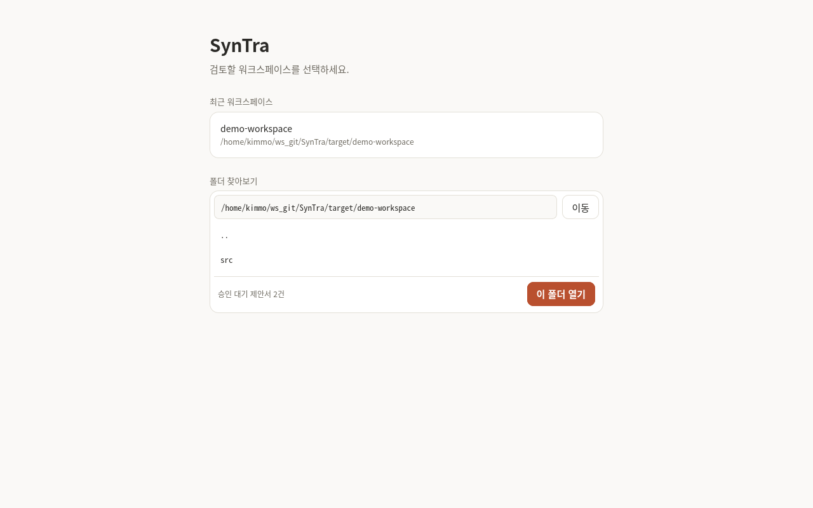

한 번 연 폴더는 **최근 워크스페이스**에 남아 다음부터는 클릭 한 번으로 열 수 있습니다. 서버가 실행 중일 때 페이지를 다시 열면 마지막에 연 워크스페이스가 바로 열리고, 다른 폴더로 바꾸려면 왼쪽 위의 `· 변경`을 누릅니다.

> 제안서 폴더(`.syntra/proposals`나 `proposals`)를 직접 골라도 그 상위 폴더가 워크스페이스로 열립니다.

### 2. 작업 목록

왼쪽 사이드바에는 제안서가 **작업** 단위로 묶여 표시됩니다. 데모의 두 제안서는 서로 다른 작업이라 `edit-main`, `create-greeting` 두 개가 보입니다. 작업으로 묶는 규칙은 [2부](#2부-작업-단위-검토)에서 설명합니다.

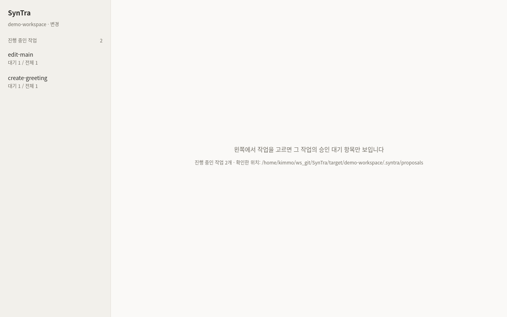

화면 아래에는 제안서를 읽어 온 위치가 표시됩니다. 제안서가 보이지 않으면 이 경로부터 확인하세요.

### 3. 생성안 검토

`create-greeting` 작업을 누르면 **작업 요약**이 열리고, 이 작업에 속한 제안서와 상태를 한눈에 볼 수 있습니다.

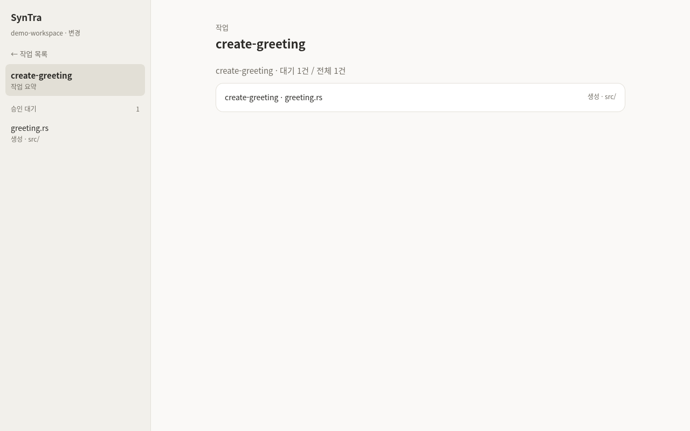

사이드바에서 `greeting.rs`를 누르면 생성안의 상세 내용이 나옵니다. 에이전트가 제안서에 적은 **생성 목적**, **배치 위치**, **코드 내용**이 그대로 표시되므로, 코드뿐 아니라 이 파일을 *왜* 만들었는지 함께 판단할 수 있습니다.

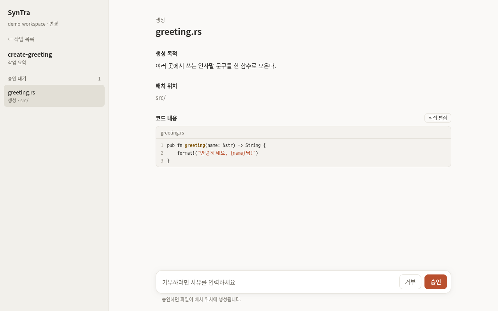

이 제안서의 원본은 다음과 같습니다([examples/proposals/create-greeting.json](../examples/proposals/create-greeting.json)).

```json
{
  "kind": "create",
  "file_name": "greeting.rs",
  "content": "pub fn greeting(name: &str) -> String {\n    format!(\"안녕하세요, {name}님!\")\n}\n",
  "purpose": "여러 곳에서 쓰는 인사말 문구를 한 함수로 모은다.",
  "location": "src/"
}
```

**승인**을 누르면 `src/greeting.rs` 파일이 생성되고, 제안서는 사이드바의 **처리됨**으로 옮겨집니다.

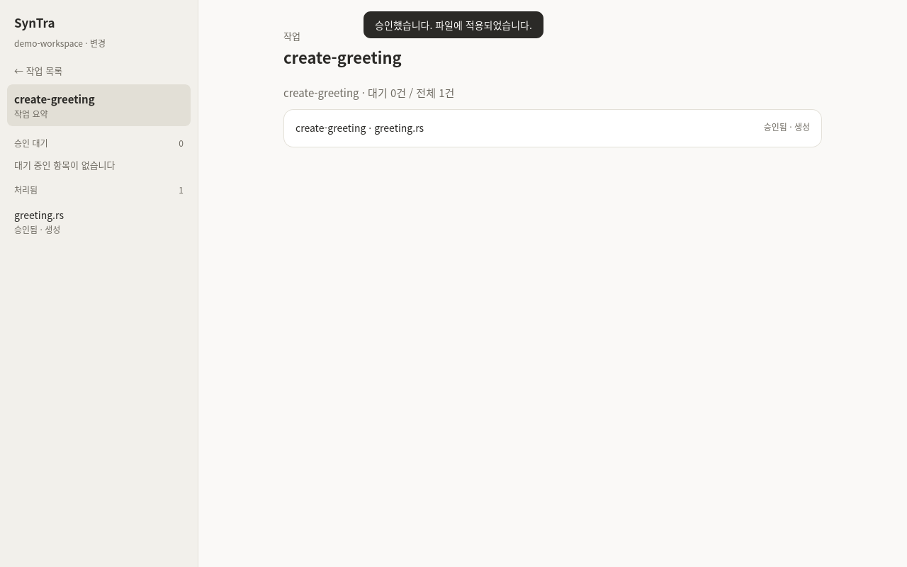

> 같은 경로에 파일이 이미 있으면 생성안은 승인되지 않습니다. 기존 파일을 덮어쓰는 일은 없습니다.

### 4. 편집안 검토: 영역별 승인

`← 작업 목록`으로 돌아가 `edit-main` 작업의 `src/main.rs`를 엽니다. 편집안은 **영역** 단위로 나뉘며, 영역마다 편집 목적과 편집 전/후 비교가 표시됩니다.

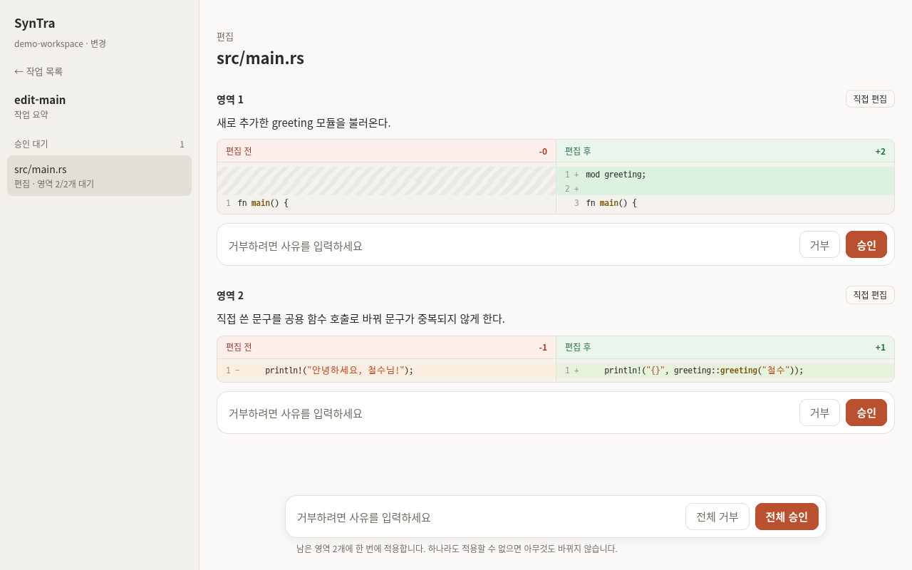

- **영역 1**: `mod greeting;`을 추가해 새 모듈을 불러옵니다.
- **영역 2**: 직접 쓴 인사말 문구를 공용 함수 호출로 바꿉니다.

영역 1의 **승인**을 누르면 그 영역만 파일에 적용되고 `승인됨 · 파일에 적용되었습니다`가 표시됩니다. 사이드바의 대기 영역 수도 `2/2`에서 `1/2`로 줄어듭니다.

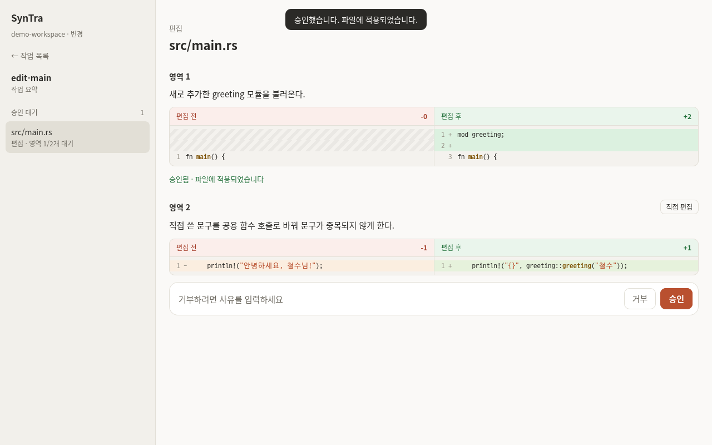

영역 2까지 승인하면 제안서 전체가 `승인됨`이 됩니다.

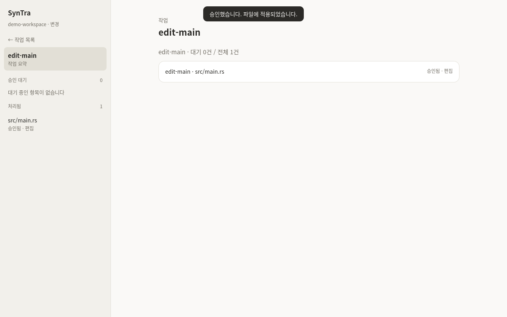

> 남은 영역이 2개 이상이면 화면 아래에 **전체 승인 / 전체 거부**가 나타납니다. 전체 승인은 *전부 적용되거나 하나도 적용되지 않는* 방식이라, 한 영역이라도 적용할 수 없으면 파일은 바뀌지 않습니다.

이제 두 작업이 모두 **완료된 작업**으로 옮겨졌습니다.

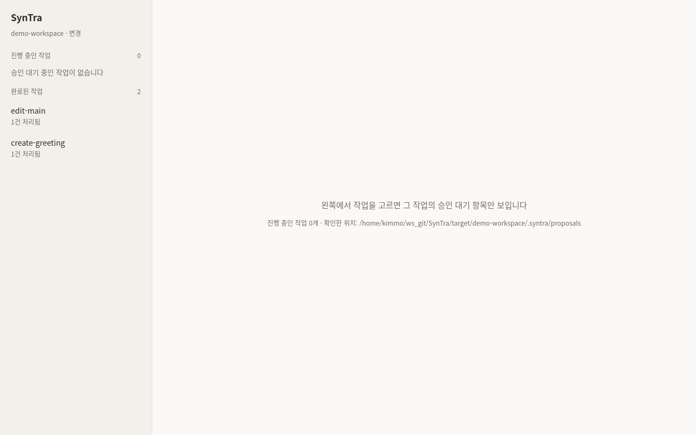

워크스페이스의 파일을 열어 보면 승인한 내용이 그대로 반영되어 있습니다.

```rust
// src/main.rs
mod greeting;

fn main() {
    println!("{}", greeting::greeting("철수"));
}
```

> 승인은 파일 내용만 바꾸며 git 커밋이나 스테이징은 하지 않습니다. 결과는 평소처럼 `git diff`로 확인하고 커밋하면 됩니다.

---

## 2부. 작업 단위 검토

실제로 에이전트는 작업 하나에 여러 파일을 고치는 제안서를 한꺼번에 보내는 경우가 많습니다. 이번에는 "작별 인사 추가" 작업으로 제안서 3개가 왔다고 가정합니다.

### 5. 제안서 추가하기

1부를 마친 워크스페이스에 [docs/tutorial/proposals](tutorial/proposals)의 제안서 3개를 복사합니다. 실제 사용할 때는 에이전트가 이 위치에 제안서를 작성합니다.

```sh
cp docs/tutorial/proposals/*.json target/demo-workspace/.syntra/proposals/
```

| 파일 | 대상 | 내용 |
|---|---|---|
| `20261113_1030_add-farewell_1.json` | `src/greeting.rs` | `farewell` 함수 추가 |
| `20261113_1030_add-farewell_2.json` | `src/main.rs` | 영역 1: 작별 인사 출력 · 영역 2: `main`에 문서 주석 추가 |
| `20261113_1030_add-farewell_3.json` | `src/main.rs` | 작별 인사 출력 (1부 이전 파일을 기준으로 작성됨) |

제안서 id는 `<날짜>_<시각>_<작업명>_<번호>` 규칙을 따릅니다. SynTra는 끝의 `_번호`를 뗀 `20261113_1030_add-farewell`을 작업 이름으로 보고, 세 제안서를 한 작업으로 묶습니다. 이 규칙 대신 제안서에 `"task": "..."` 필드를 직접 적어도 됩니다.

### 6. 승인 전에 미리 검사하기: `syntra check`

`syntra check`는 대기 중인 제안서를 지금 승인하면 적용되는지 미리 검사합니다. 파일은 바꾸지 않습니다. 에이전트가 제안서를 넘기기 전에 스스로 실행하도록 하면, 검토자는 적용할 수 없는 제안서를 받지 않게 됩니다.

```console
$ syntra check target/demo-workspace
통과 20261113_1030_add-farewell_1
통과 20261113_1030_add-farewell_2
실패 20261113_1030_add-farewell_3: 적용할 수 없습니다. 영역 1: 편집 전 코드를 파일에서 찾을 수 없습니다
target/demo-workspace/.syntra/proposals: 3건 검사, 1건 실패
```

하나라도 실패하면 종료 코드가 1이므로 스크립트나 에이전트의 확인 단계에 그대로 넣을 수 있습니다. 특정 제안서만 검사하려면 id를 뒤에 덧붙입니다.

`3`번은 1부에서 이미 바뀐 `println!("안녕하세요, 철수님!");` 줄을 기준으로 작성되어 실패했습니다. 이런 문제를 막으려면 에이전트가 `syntra cat`으로 파일을 읽게 합니다. `syntra cat`은 SynTra가 승인할 때 비교하는 내용을 그대로 출력합니다(인코딩과 줄바꿈 정보는 표준 오류로 출력).

```console
$ syntra cat target/demo-workspace src/main.rs 3 5
src/main.rs: UTF-8, LF, 6줄 중 3-5줄
fn main() {
    println!("{}", greeting::greeting("철수"));
    println!("{}", greeting::farewell("철수"));
```

> `cargo install --path crates/syntra-server`로 설치하면 `syntra` 명령을 바로 쓸 수 있습니다. 설치하지 않았다면 `cargo run --release -- check ...`로 실행합니다.

### 7. 작업 단위로 보기

검토 화면에서 워크스페이스를 다시 엽니다(또는 새로고침). 세 제안서가 `add-farewell` 작업 하나로 묶이고, id의 날짜와 시각이 함께 표시됩니다.

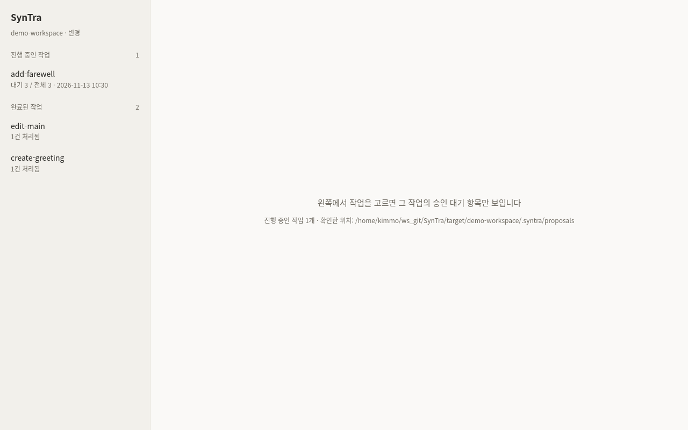

작업을 열면 작업 요약에서 제안서 3개를 번호 순서로 볼 수 있습니다.

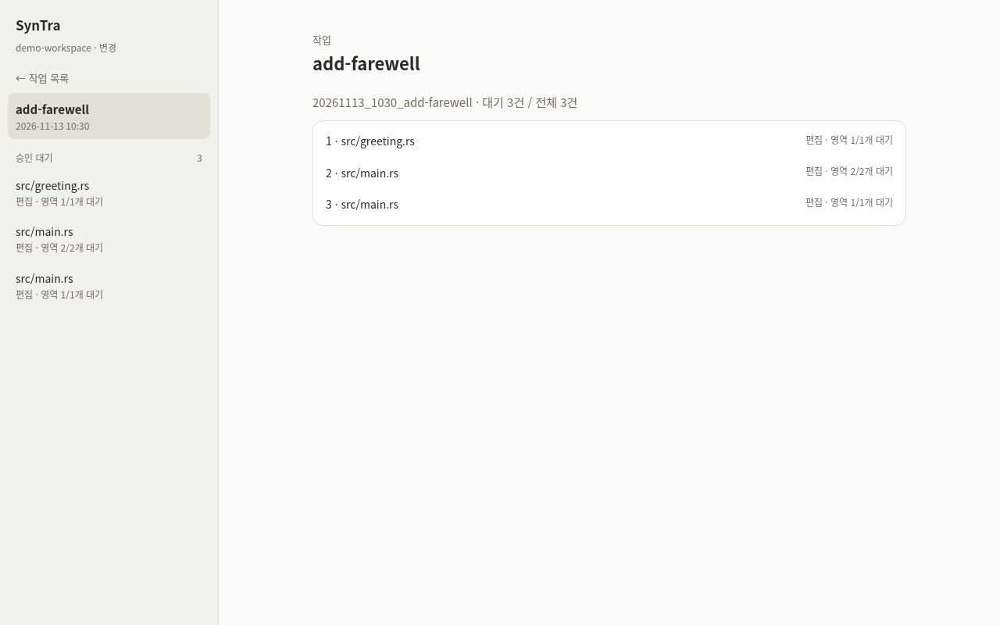

### 8. 적용할 수 없는 제안서 거부하기

`3`번 제안서(`src/main.rs`, 영역 `1/1`)를 열고 **승인**을 누르면, `check`에서 본 것과 같은 이유로 승인이 거부됩니다. 이 경우 파일은 바뀌지 않습니다.

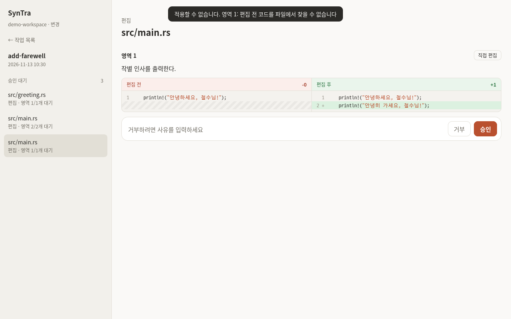

사유 입력란에 `2번 제안서와 같은 변경이고, 편집 전 코드가 현재 파일과 다릅니다.`를 적고 **거부**를 누릅니다. **거부할 때는 사유가 반드시 필요합니다.** 사유는 제안서 파일에 기록되어 에이전트가 다음 작업에서 읽을 수 있습니다.

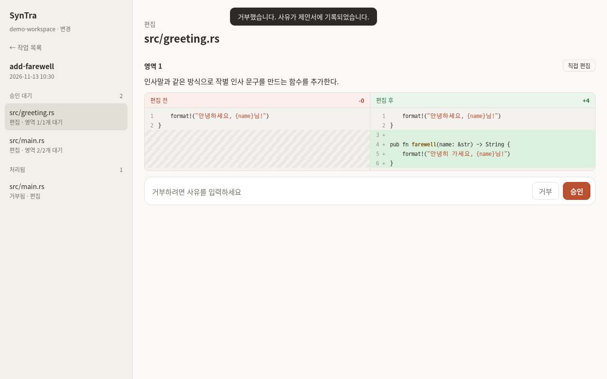

### 9. 직접 편집한 뒤 승인하기

`1`번 제안서(`src/greeting.rs`)는 내용은 좋지만 문구만 바꾸고 싶다고 해 봅시다. 거부하고 다시 요청하는 대신 영역 오른쪽 위의 **직접 편집**을 누르면 *편집 후* 코드를 바로 고칠 수 있습니다. 여기서는 `안녕히 가세요`를 `다음에 또 만나요`로 바꿉니다.

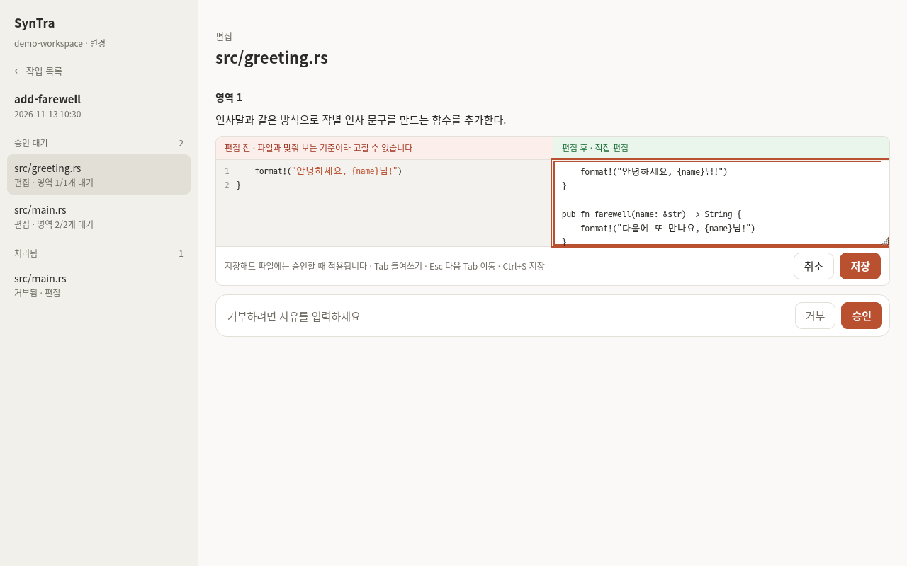

- *편집 전* 코드는 파일과 맞춰 보는 기준이므로 고칠 수 없습니다.
- 편집기에서 Tab은 들여쓰기, Esc 다음 Tab은 편집기 밖으로 이동, Ctrl+S는 저장입니다.

**저장**하면 수정한 내용이 제안서에 기록되고 `직접 수정함` 표시가 붙습니다. 파일에는 아직 아무것도 적용되지 않았습니다.

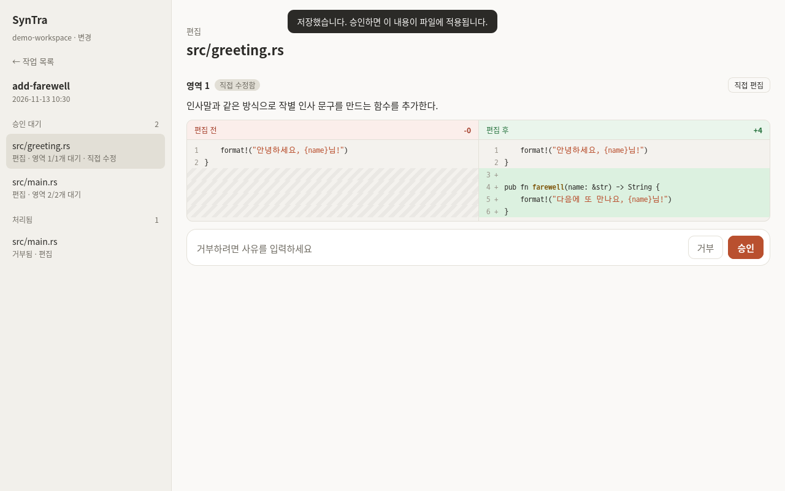

**승인**을 누르면 수정한 내용이 파일에 적용됩니다. 제안서에는 `"edited": true`가 남으므로, 나중에 검토자가 손댄 제안서를 구분할 수 있습니다.

### 10. 일부 영역만 승인하기

`2`번 제안서(`src/main.rs`, 영역 `2/2`)를 엽니다. 영역 1(작별 인사 출력)은 **승인**합니다. 영역 2(문서 주석 추가)는 이번 작업 범위가 아니라고 보고, 사유 `문서 주석은 이번 작업 범위가 아닙니다.`를 적은 뒤 **거부**합니다.

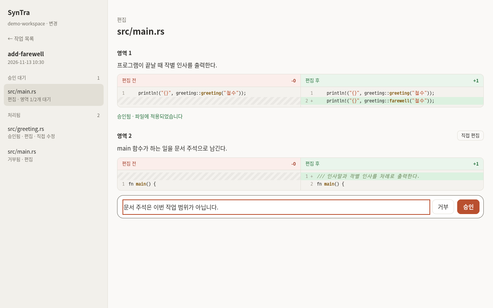

모든 영역을 검토하면 제안서 전체의 결과가 정해집니다. 승인과 거부가 섞여 있으므로 `일부 승인`이 되며, 영역마다 결과와 거부 사유가 함께 표시됩니다. 영역 하나를 거부해도 이미 승인한 영역은 되돌려지지 않습니다.

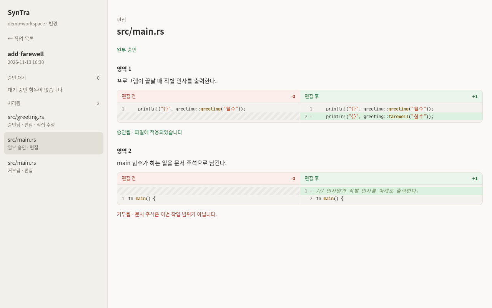

### 11. 결과 확인

작업 요약에서 세 제안서의 결과를 한눈에 볼 수 있습니다.

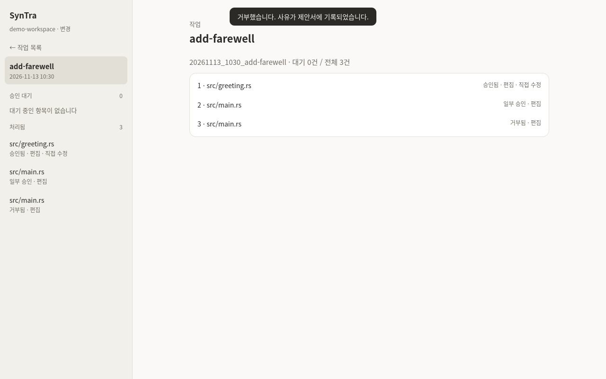

최종 파일은 다음과 같습니다. 거부한 문서 주석은 빠졌고, 직접 수정한 문구가 반영되었습니다.

```rust
// src/main.rs
mod greeting;

fn main() {
    println!("{}", greeting::greeting("철수"));
    println!("{}", greeting::farewell("철수"));
}
```

```rust
// src/greeting.rs
pub fn greeting(name: &str) -> String {
    format!("안녕하세요, {name}님!")
}

pub fn farewell(name: &str) -> String {
    format!("다음에 또 만나요, {name}님!")
}
```

검토 결과는 각 제안서 파일의 `review`에 기록됩니다. 예를 들어 `2`번 제안서는 다음과 같이 바뀝니다.

```json
{
  "kind": "edit",
  "file_name": "src/main.rs",
  "regions": [
    {
      "before": "...",
      "after": "...",
      "purpose": "프로그램이 끝날 때 작별 인사를 출력한다.",
      "review": { "status": "approved" }
    },
    {
      "before": "...",
      "after": "...",
      "purpose": "main 함수가 하는 일을 문서 주석으로 남긴다.",
      "review": { "status": "rejected", "reason": "문서 주석은 이번 작업 범위가 아닙니다." }
    }
  ],
  "review": { "status": "partially_approved" }
}
```

---

## 부록

### 에이전트에게 알려 줄 규칙

에이전트가 SynTra에 맞는 제안서를 작성하도록 프롬프트나 `CLAUDE.md` 같은 지침 파일에 다음 내용을 넣어 두면 좋습니다.

- 코드를 직접 고치지 말고 `.syntra/proposals/<id>.json`에 제안서를 작성한다. `<id>`는 `<YYYYMMDD>_<HHMM>_<작업명>_<번호>` 형식이며 영문, 숫자, `-`, `_`만 쓴다.
- 생성안에는 `file_name`, `content`, `purpose`, `location`을, 편집안에는 영역마다 `before`, `after`, `purpose`를 적는다.
- `before`는 파일에서 **정확히 한 곳**과 일치해야 한다. 파일은 `syntra cat`으로 읽는다.
- 제안서를 넘기기 전에 `syntra check <워크스페이스>`를 실행해 모두 통과하는지 확인한다.
- 다음 작업을 시작하기 전에 이전 제안서의 `review`(특히 거부 사유)를 읽는다.

### 인코딩과 줄바꿈

승인할 때 SynTra는 파일의 원래 인코딩(UTF-8, UTF-8 BOM, UTF-16LE BOM, CP949)과 줄바꿈(LF/CRLF)을 유지한 채 내용만 바꿉니다. 새 파일이나 ASCII 문자만 있던 파일에 쓸 인코딩과 줄바꿈은 워크스페이스의 `.syntra/config.json`으로 정합니다.

```json
{ "encoding": "cp949", "line_ending": "crlf" }
```

`encoding`은 `utf-8`(기본값), `utf-8-bom`, `utf-16le-bom`, `cp949` 중 하나입니다. `line_ending`을 생략하면 제안서에 적힌 줄바꿈을 그대로 씁니다.

### 승인할 수 없는 경우 정리

| 상황 | 결과 |
|---|---|
| 생성안: 같은 경로에 파일이 이미 있음 | 승인 거부, 파일 변경 없음 |
| 편집안: `before`가 파일에서 0곳 또는 2곳 이상과 일치 | 승인 거부, 파일 변경 없음 |
| 경로가 워크스페이스 밖, `.git`, `.syntra`, 제안서 폴더를 가리킴 | 승인 거부 |
| 파일 인코딩으로 표현할 수 없는 문자가 `after`에 있음 (예: CP949 파일에 이모지) | 승인 거부, 파일 변경 없음 |
